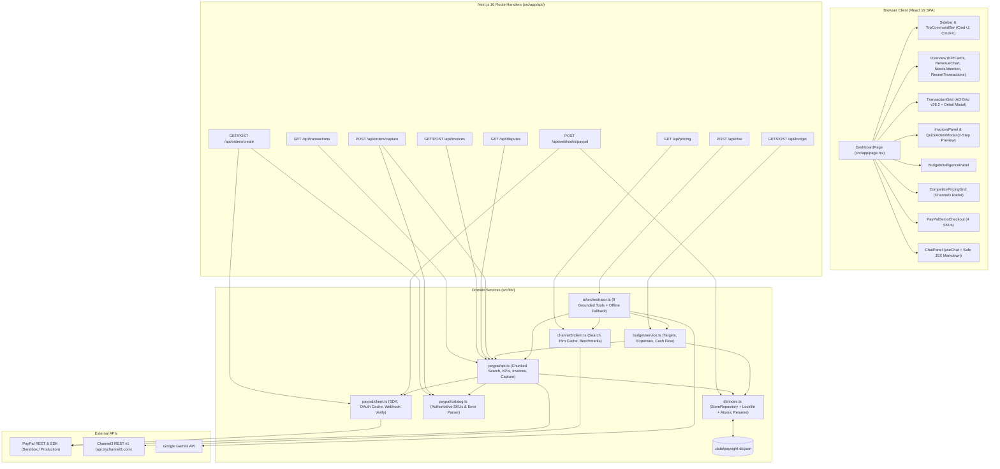
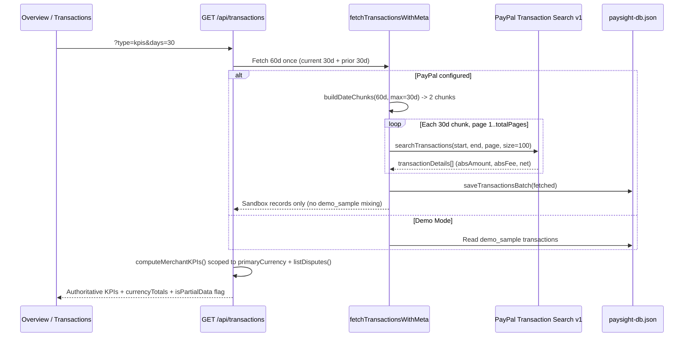
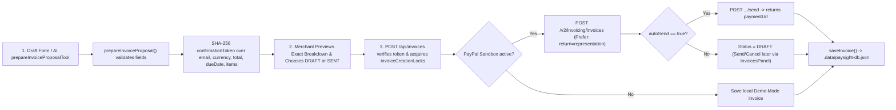
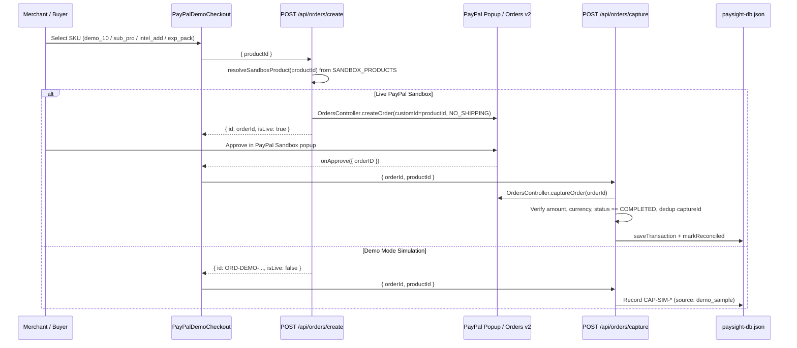
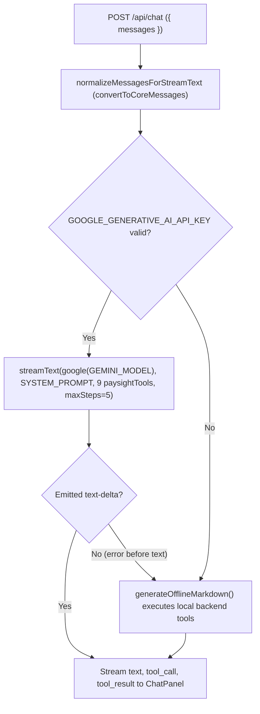

# ARCHITECTURE.md — PaySight System Architecture

## 1. High-Level Overview

PaySight is structured as a **Next.js App Router Modular Monolith** with strict separation between browser UI (`src/components/`), HTTP route boundaries (`src/app/api/`), pure & external domain services (`src/lib/`), and file-locked persistence (`src/lib/db/`).

---

## 2. PayPal Transaction Retrieval & Currency-Safe KPI Flow

---

## 3. Invoice Two-Step Proposal, Creation & Webhook Lifecycle

### Fail-Closed Webhook Processing (`POST /api/webhooks/paypal`)

1. Extract all 5 required PayPal transmission headers (`paypal-transmission-id`, `paypal-transmission-time`, `paypal-cert-url`, `paypal-auth-algo`, `paypal-transmission-sig`).
2. Verify `PAYPAL_WEBHOOK_ID` and live PayPal config exist (`503` if unconfigured).
3. Enforce HTTPS `*.paypal.com` certificate host and verify signature via PayPal `/v1/notifications/verify-webhook-signature` (`401` on failure).
4. Deduplicate via `isEventProcessed(event.id)`.
5. Merge invoice updates into existing stored records (`getStoredInvoiceById`), preserving line `items` and preventing `SENT` webhooks from downgrading `PAID` status.

---

## 4. Buyer-Approved Checkout Flow

---

## 5. Grounded AI Tool & Fallback Architecture

Untrusted fields returned by tools (`customer`, `product`, `note`, `retailer`, `title`, `reason`) pass through `sanitizeUntrustedField()` and are bound by explicit system prompt boundaries against indirect prompt injection.

---

## 6. Persistence & Concurrency Design (`src/lib/db/index.ts`)

- **Interface**: `StoreRepository` encapsulates transactions, invoices, processed webhook IDs, reconciled capture IDs, operating expenses, and monthly budget targets so an external SQL store can replace JSON storage without rewriting services.
- **Locking & Atomicity**: `withFileLock()` creates an exclusive `.lock` file (`O_EXCL` / `"wx"`) with stale-lock recovery (`> 5s`) and `Atomics.wait` backoff, then writes to `.tmp.<pid>.<uuid>` before `fs.renameSync`.
- **Corruption Recovery**: Malformed JSON files are copied to `<dbFile>.corrupt.<timestamp>` before re-seeding instead of overwriting silently.

