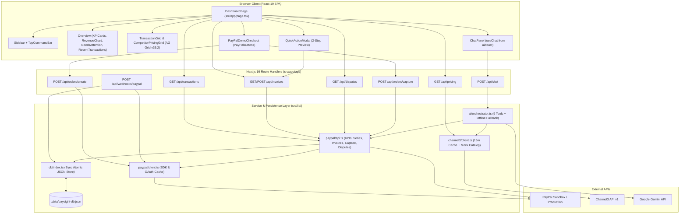
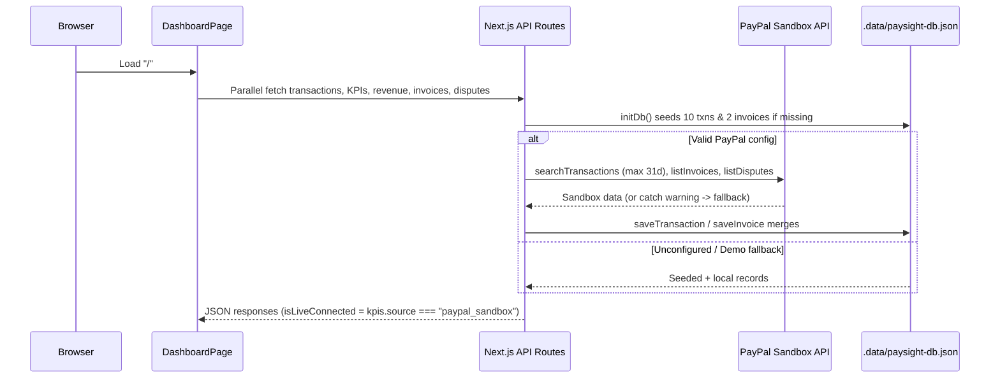
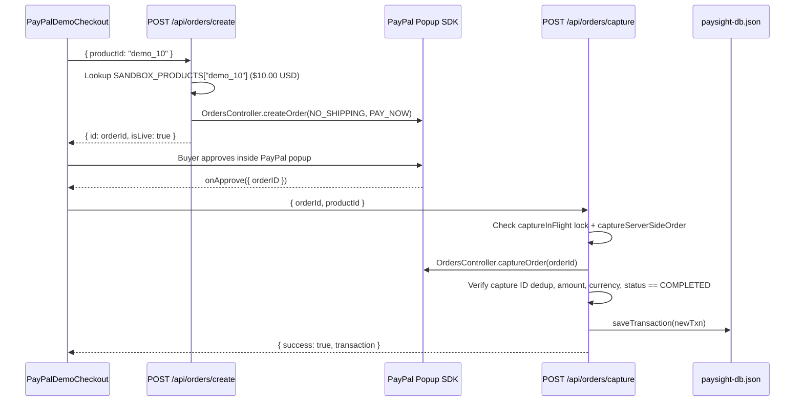
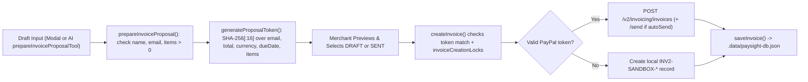
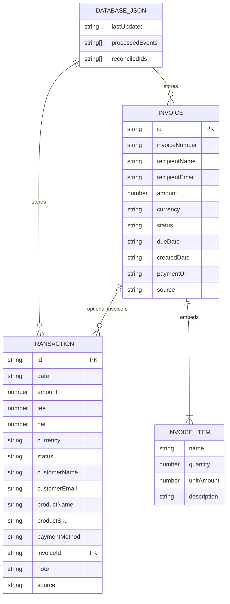

# PaySight — Comprehensive Project Intelligence & Codebase Audit

## Executive Summary Snapshot

- **What this project is**: **PaySight** (`paysight` `v0.1.0`, branded `PaySight v2.0` in the sidebar) is a Next.js 16 (App Router) and TypeScript single-page merchant dashboard and operations workspace for PayPal business accounts (`package.json`, `src/components/layout/Sidebar.tsx:95-100`).
- **What it does**: It consolidates 30-day PayPal payment KPIs, a 7/30/90-day settlement velocity chart, a searchable/exportable transaction ledger, a two-step preview-confirmed PayPal invoice creator, multi-retailer price benchmarking via Channel3, live PayPal dispute monitoring, a buyer-approved PayPal Sandbox checkout test terminal, an idempotent PayPal webhook receiver, and a grounded AI copilot drawer (`src/app/page.tsx:27-523`).
- **How it works**: The client dashboard (`src/app/page.tsx`) communicates with eight Next.js App Router API routes (`src/app/api/*`), which coordinate PayPal Sandbox SDK/REST operations (`src/lib/paypal/`), Channel3 REST searches (`src/lib/channel3/client.ts`), Vercel AI SDK `streamText` tool execution against Google Gemini (`src/lib/ai/orchestrator.ts`), and synchronous atomic JSON persistence at `.data/paysight-db.json` (`src/lib/db/index.ts`). Every external integration degrades to deterministic local data or an offline keyword-based markdown fallback when keys are absent or upstream calls fail.
- **What has been implemented**: 6-view responsive UI shell; server-side SKU catalog pricing (`SANDBOX_PRODUCTS` / `CAPTURE_PRODUCT_AMOUNTS`) with PayPal capture verification and SDK `CustomError.result` diagnostics; SHA-256 confirmation-token binding (`generateProposalToken`) and in-flight locks for invoicing; Channel3 search with exact vs. approximate matching and 15-minute memory cache; webhook event deduplication; honest empty/status reporting for disputes; 9 grounded AI assistant tools + offline fallback stream; and 5 `node:test` suites (`30` total test blocks/subtests).
- **What is incomplete**: Zero user authentication or API authorization exists; PayPal transaction search lacks >31-day date chunking and pagination beyond 100 items; multi-currency KPI totals mix currencies under a `"USD"` label; `disputeRate` (`0.0`) and the chart `+14.8% trend` badge are hardcoded; `createPaymentLink` generates synthetic 404 URLs; saved draft invoices cannot be sent/cancelled in the UI; top-bar global search only filters transactions (`⌘K` unbound); tests write into the live `.data/paysight-db.json` file; and 6 packages declared in `package.json` have zero imports.
- **Most important technical findings**:
  1. **Unauthenticated webhook bypass & invoice overwrite (`HIGH`)**: `POST /api/webhooks/paypal` skips signature verification whenever PayPal transmission headers are omitted (`src/app/api/webhooks/paypal/route.ts:18-32`), `verifyWebhookSignature` passes when `PAYPAL_WEBHOOK_ID` is unset (`src/lib/paypal/client.ts:152-185`), and `INVOICING.INVOICE.PAID` overwrites stored `items` with `[]`.
  2. **Financial math, 31-day truncation & DB write race (`HIGH`)**: `listTransactions` clamps `Math.min(days, 31)` breaking 60d period comparisons and 90d charts (`src/lib/paypal/api.ts:78-90`), computes `amountVal - feeVal` without `Math.abs` on negative PayPal fees (`api.ts:98-107`), mixes currencies in `getMerchantKPIs` (`api.ts:185-238`), hardcodes `disputeRate: 0.0`, and triggers concurrent `saveDb()` calls colliding on `tmp.${Date.now()}` filenames (`src/lib/db/index.ts:217-219`).
  3. **AI Copilot grounding & streaming edge bugs (`MEDIUM`)**: `summarizePayments` ignores its `days` and `currency` inputs for headline totals (`src/lib/ai/orchestrator.ts:45-66`), mid-turn tool errors leave blank bubbles (`orchestrator.ts:487-528`), `ChatPanel` ignores `toolInvocations` and renders raw Markdown (`src/components/ai/ChatPanel.tsx:148`), `messages` skip `convertToCoreMessages`, and `.env.example` defaults `GEMINI_MODEL` to `gemini-omni-1.1-flash`.
  4. **Checkout Demo Mode mismatch & mocked payment links (`MEDIUM`)**: `PayPalDemoCheckout` exposes only `demo_10` (`$10.00`) despite 4 SKUs on the server (`src/components/checkout/PayPalDemoCheckout.tsx:35-41`), `POST /api/orders/create` returns HTTP `500` when PayPal keys are blank instead of falling back to Demo Mode (`src/app/api/orders/create/route.ts:45-57`), and `createPaymentLink` always fabricates dummy `LINK-*` URLs (`src/lib/paypal/api.ts:608-619`).

---

## 1. Executive Summary

**PaySight** is a prototype/hackathon-grade merchant command center built with Next.js 16, React 19, TypeScript, AG Grid Community, Recharts, PayPal Sandbox APIs, Channel3, and Google Gemini (`README.md:1-74`, `package.json:12-32`). It gives a merchant operator one interface to track settlement velocity and KPIs, explore and export transactions, prepare and preview-confirm PayPal invoices, benchmark catalog prices against retail competitors, inspect PayPal disputes, run a live buyer-approved Sandbox checkout, and ask a tool-grounded AI copilot questions about store performance.

At audit completion, `npm ci` installed `646` packages (`24` reported npm vulnerabilities: `9 moderate, 15 high`), `npx tsc --noEmit` and `npm run build` passed with `0` errors (building `/` statically and all 8 API routes dynamically; note `next/font/google` requires outbound access to `fonts.googleapis.com`), `npm run lint` passed with `0` errors and `1` unused-variable warning (`_legacyCurrency` in `src/lib/paypal/api.ts:637`), and `npm test` failed `2` of `30` cases (`28` passed) due to the exact `saveDb()` millisecond temp-file race (`ENOENT` on `renameSync`) identified in static review (which also created `.data/paysight-db.json`). Static analysis also shows missing authentication across all routes, unguarded webhook paths, 31-day PayPal lookback truncation, mixed-currency KPI totals, mocked payment links, and 6 unused dependencies left over from pre-refactor hackathon work.

---

## 2. Project Identity and Purpose

| Attribute | Verified Value | Evidence Source |
|---|---|---|
| Package name & version | `paysight` `0.1.0` (`PaySight v2.0` in UI header) | `package.json:2-3`, `src/components/layout/Sidebar.tsx:95-100` |
| License | MIT (`Copyright (c) 2026 PaySight Contributors`) | `LICENSE:1-3` |
| Git remote | `https://github.com/yugomania/Paysight.git` (docs/UI link to `yugomania/ai-interface`) | `git remote -v`, `README.md:102`, `Sidebar.tsx:246` |
| Application category | Merchant Financial Analytics & Commerce Intelligence Dashboard | `src/app/layout.tsx:15-19` |
| Intended users | PayPal merchants and demo/hackathon evaluators (`judge@hackathon.dev`) | `src/components/layout/Sidebar.tsx:241-242`, `README.md:135-137` |
| Core problem solved | Eliminates context-switching across PayPal reporting, invoicing tools, and competitor storefronts while guarding against LLM arithmetic hallucinations and accidental invoice sends | `README.md:139-142`, `src/lib/ai/orchestrator.ts:27-33` |

*Inference from commit history (`f264bc9`, `c58ce72`)*: PaySight originated as a multi-sponsor hackathon application (PayPal, AG Grid, Channel3, APIMatic, Render) and later underwent an audit refactor replacing `@paypal/agent-toolkit` and APIMatic prompt text with custom grounded tools, SHA-256 confirmation tokens, and a buyer-approved `PayPalButtons` sandbox flow.

---

## 3. Product Overview

### Primary User Journeys

1. **Zero-Config Demo vs. Live PayPal Sandbox**: On load, `DashboardPage` fetches `/api/transactions` (list, KPIs, series), `/api/invoices`, and `/api/disputes` in parallel. If valid PayPal credentials are missing, an orange `Demo Mode Active` banner appears and deterministic sample records load from `.data/paysight-db.json` (`src/app/page.tsx:215-227`).
2. **Analytics & Transaction Explorer**: Merchants inspect 4 KPI cards (`Total Net Volume`, `Settled Orders`, `Avg Transaction Size`, `Dispute / Risk Rate`), toggle `7d`/`30d`/`90d` on the Recharts `Settlement Velocity` curve, check `Needs Attention` alerts (open disputes + overdue invoices), and open the AG Grid `Transactions` explorer with status segment filters (`All`, `Completed`, `Pending`, `Exceptions`), text search, pagination, and CSV export (`src/components/dashboard/TransactionGrid.tsx:104-338`).
3. **Competitive Pricing Radar (Channel3)**: Opening `Price comparison` benchmarks 4 preset products or user-submitted SKUs/prices against Channel3 listings (or structured fallback catalogs), splitting exact vs. approximate matches and opening a retailer-link drilldown modal (`src/components/dashboard/CompetitorPricingGrid.tsx:84-367`).
4. **Two-Step Confirmed Invoicing**: `+ New Invoice` opens `QuickActionModal` (`EDIT` -> `PREVIEW` -> `SUCCESS`). Step 1 calls `POST /api/invoices` (`validate_proposal`) for a SHA-256 `confirmationToken`; Step 2 previews totals and chooses `Create as DRAFT` (default) or `Create and SEND immediately`; Step 3 commits the invoice to PayPal Invoicing v2 or local storage (`src/components/dashboard/QuickActionModal.tsx:15-454`).
5. **Sandbox Checkout**: Under `Demo Tools -> Sandbox checkout`, `PayPalDemoCheckout` renders official PayPal popup buttons for `PaySight Demo Product` (`$10.00 USD`, `demo_10`). Creating an order, approving in the popup, and capturing via `/api/orders/capture` records a verified `COMPLETED` transaction in the ledger (`src/components/checkout/PayPalDemoCheckout.tsx:53-326`).
6. **AI Copilot (`Cmd+J` / `Ask PaySight`)**: Opens `ChatPanel`, streaming Gemini responses with 9 grounded server tools or falling back to deterministic offline Markdown templates (`src/components/ai/ChatPanel.tsx:20-212`, `src/lib/ai/orchestrator.ts:37-535`).

### Intended Product vs. Actual Implementation

| Intended / Documented Capability | Actual State | Evidence |
|---|---|---|
| APIMatic context & `@paypal/agent-toolkit` integration | Removed in `c58ce72`; dependency & README claim left stale | `README.md:84`, `package.json:16`, `src/lib/ai/orchestrator.ts` |
| Date-chunked PayPal transaction history (60d/90d) | Clamped at `Math.min(days, 31)` and `page: 1, pageSize: 100` | `README.md:170`, `src/lib/paypal/api.ts:78-90` |
| Pro Plan (`$49.00`) & multi-SKU sandbox checkout | Server catalog defines 4 SKUs; UI exposes only `demo_10` (`$10.00`) | `README.md:162-164`, `src/components/checkout/PayPalDemoCheckout.tsx:35-41` |
| Shareable PayPal Payment Links | Always returns synthetic `LINK-*` placeholder URLs | `src/lib/paypal/api.ts:608-619` |
| Global search (`⌘K`) across transactions, customers, invoices | Filters only `TransactionGrid`; `⌘K` listener absent | `src/components/layout/TopCommandBar.tsx:53-58`, `src/app/page.tsx:155-167` |

---

## 4. Technology Stack

| Layer | Technology / Package | Declared Version | Usage Status | Reference |
|---|---|---|---|---|
| Language | TypeScript | `^5` (`strict: true`) | Active across `src/` and `tests/` | `tsconfig.json:7` |
| Framework | Next.js (App Router, Turbopack) | `16.4.2` | Active (`src/app/`, route handlers) | `package.json:26`, `next.config.ts:3-12` |
| UI Runtime | React / React DOM | `19.3.0` | Root Server Layout + Client SPA | `src/app/layout.tsx`, `src/app/page.tsx` |
| Styling | Tailwind CSS + `@tailwindcss/turbopack` | `^4` (`4.3.3` locked) | Tokens + Quartz CSS theme overrides | `src/app/globals.css:1-115` |
| Data Grids | `ag-grid-community`, `ag-grid-react` | `^36.2.0` | Active (`theme="legacy"`) | `src/components/dashboard/TransactionGrid.tsx:4-12` |
| Unused Grid Package | `ag-grid-enterprise` | `^36.2.0` | Zero imports; only Community registered | `package.json:20` |
| Charts | `recharts` | `^3.10.1` | `ResponsiveContainer` + `AreaChart` | `src/components/dashboard/RevenueChart.tsx:3-11` |
| Icons / Dates / Validation | `lucide-react`, `date-fns`, `zod` | `^1.59.0`, `^4.4.0`, `^3.25.76` | Active in UI, date math, and AI tool schemas | `package.json:24-30` |
| AI SDK | `ai`, `@ai-sdk/google` | `^4.3.19`, `^1.2.22` | `useChat` via `ai/react`; `streamText` + `google()` | `src/components/ai/ChatPanel.tsx:3`, `src/lib/ai/orchestrator.ts:1-2` |
| Unused AI/State/HTTP Deps | `@ai-sdk/openai`, `@ai-sdk/react`, `@paypal/agent-toolkit`, `zustand`, `axios` | `^4.0.96`, `^4.0.147`, `^1.11.0`, `^5.0.15`, `^1.20.0` | Zero imports across `src/` and `tests/` | `package.json:14-31` |
| PayPal SDKs | `@paypal/paypal-server-sdk`, `@paypal/react-paypal-js` | `^2.5.0`, `^10.6.0` | Orders/Search controllers + `PayPalButtons` | `src/lib/paypal/client.ts:1-7`, `PayPalDemoCheckout.tsx:18-22` |
| Storage | Node `fs` JSON file | Built-in Node | Atomic rename writes to `.data/paysight-db.json` | `src/lib/db/index.ts:13-220` |
| Test & Lint | `tsx`, `node:test`, `eslint` (`eslint-config-next`) | `^4.23.15`, Node built-in, `^9` / `16.4.2` | Verified locally: `tsc` pass, `eslint` pass (1 warning), `test` 28/30 pass (`ENOENT` race fail) | `package.json:9-10`, `eslint.config.mjs` |

---

## 5. Architecture Overview

PaySight is a **Next.js Full-Stack Modular Monolith**: a single client-rendered page (`src/app/page.tsx`) communicating over HTTP/SSE with Next.js Route Handlers (`src/app/api/*`), which invoke domain service modules (`src/lib/*`) backed by a local synchronous JSON file (`.data/paysight-db.json`).

### System Architecture Diagram



### Startup & Dashboard Fetch Sequence



### Buyer-Approved Checkout & Invoice Confirmation Workflows





### Infrastructure Behavior

- **State management**: Local React state in `src/app/page.tsx` and child components (`zustand` is unused).
- **Caching**: Module-level `_tokenCache` for PayPal OAuth2 (`expires_in - 60s`) in `src/lib/paypal/client.ts:56-114`; unbounded 15-minute `Map` cache in `src/lib/channel3/client.ts:14-25`.
- **Background tasks / queues**: None; all persistence and external calls run inline within request lifecycles.
- **Logging**: Standard `console.info`, `console.warn`, and `console.error`; upstream retrieval errors degrade silently to local data except `/api/orders/*` and `POST /api/invoices`.

---

## 6. Repository Structure

```text
Paysight/
├── .env.example                    # Template environment variables (stale GEMINI_MODEL, missing PAYPAL_WEBHOOK_ID)
├── .env.local                      # Local env credentials (8 keys SET; values omitted)
├── .gitignore                      # Ignores node_modules, .next, .data/, .env* (except !.env.example)
├── AGENTS.md                       # Next.js agent guidance referencing node_modules/next/dist/docs/
├── LICENSE                         # MIT License (2026 PaySight Contributors)
├── README.md                       # Setup, architecture diagram, demo script (contains outdated claims)
├── eslint.config.mjs               # ESLint 9 flat config (eslint-config-next core-web-vitals + typescript)
├── next.config.ts                  # Turbopack CSS rule for @tailwindcss/turbopack
├── package.json                    # Scripts (dev, build, start, lint, test) & 19 dependencies (6 unused)
├── package-lock.json               # Locked graph (shows ai@4.3.19 vs nested @ai-sdk/react -> ai@7.0.143)
├── render.yaml                     # Render free-tier web service blueprint
├── public/                         # Starter SVGs (file.svg, globe.svg, next.svg, vercel.svg, window.svg)
├── src/
│   ├── app/
│   │   ├── globals.css             # Tailwind v4 + AG Grid Quartz CSS + design tokens
│   │   ├── layout.tsx              # Root layout with Geist & Geist_Mono fonts and metadata
│   │   ├── page.tsx                # 6-tab dashboard controller + inline Invoices/Disputes views (523 lines)
│   │   └── api/
│   │       ├── chat/route.ts       # POST streaming copilot endpoint
│   │       ├── disputes/route.ts   # GET PayPal Customer Disputes proxy
│   │       ├── invoices/route.ts   # GET list / POST validate or create invoice
│   │       ├── orders/
│   │       │   ├── create/route.ts # POST PayPal Order creation from SANDBOX_PRODUCTS
│   │       │   └── capture/route.ts# POST server-side capture verification & lock
│   │       ├── pricing/route.ts    # GET Channel3 price comparison
│   │       ├── transactions/route.ts# GET transactions, KPIs, or revenue time series
│   │       └── webhooks/paypal/route.ts # POST PayPal webhook receiver & dedup handler
│   ├── components/
│   │   ├── ai/ChatPanel.tsx        # Collapsible AI drawer (useChat from ai/react)
│   │   ├── checkout/PayPalDemoCheckout.tsx # Live PayPalButtons checkout for demo_10 ($10)
│   │   ├── dashboard/
│   │   │   ├── CompetitorPricingGrid.tsx # AG Grid radar, custom search form, drilldown modal
│   │   │   ├── KPICards.tsx        # 4 KPI metric cards
│   │   │   ├── NeedsAttention.tsx  # Alert panel for open disputes & overdue invoices
│   │   │   ├── OverviewQuickActions.tsx # 4 action tiles on Overview tab
│   │   │   ├── QuickActionModal.tsx# 2-step invoice EDIT -> PREVIEW -> SUCCESS modal
│   │   │   ├── RecentTransactions.tsx # 5-row overview transaction preview
│   │   │   ├── RevenueChart.tsx    # Recharts 7/30/90d area chart (+ hardcoded +14.8% badge)
│   │   │   └── TransactionGrid.tsx # AG Grid transaction ledger with tabs, search, CSV export
│   │   └── layout/
│   │       ├── Sidebar.tsx         # Black navigation spine + environment badge + repo link
│   │       └── TopCommandBar.tsx   # Sticky search bar, Ask PaySight, Refresh, + New Invoice
│   ├── lib/
│   │   ├── ai/orchestrator.ts      # System prompt, 9 tools, offline markdown fallback, SSE stream (536 lines)
│   │   ├── channel3/client.ts      # Channel3 v1 client, 15m cache, exact/approx matchers, mock catalogs
│   │   ├── db/index.ts             # Synchronous atomic JSON file store + seed records
│   │   └── paypal/
│   │       ├── api.ts              # Transactions, KPIs, Invoicing, Disputes, Capture, Payment Links (759 lines)
│   │       └── client.ts           # PayPal SDK client singleton, OAuth cache, webhook verify helper
│   └── types/index.ts              # Domain TypeScript interfaces
└── tests/
    ├── analytics.test.ts           # Server KPI, currencyTotals, refunds, AOV, dispute honesty tests
    ├── assistant_grounding.test.ts # Dashboard-tool alignment, invoice tool, offline/chat stream tests
    ├── invoicing.test.ts           # Proposal validation, token binding, draft default, lock tests
    ├── pricing.test.ts             # Channel3 attributes, exact/approx counts, benchmarks, custom queries
    └── reconciliation_and_webhooks.test.ts # Capture verify, dedup, webhook 401/idempotency/refund tests
```

---

## 7. Feature Inventory

| # | Feature | Status | Files | Notes & Limitations |
|---|---|---|---|---|
| 1 | Navigation & Multi-Tab UI Shell | **FULLY IMPLEMENTED** (static) | `src/app/page.tsx`, `Sidebar.tsx`, `TopCommandBar.tsx` | Responsive drawer + chat drawer (`Cmd+J` / `Esc`); `⌘K` badge unbound; client state only (no URL routing). |
| 2 | Server KPIs & Period Comparisons | **BROKEN/SUSPECTED** | `src/lib/paypal/api.ts:160-239`, `KPICards.tsx` | Currency mixing in `grossVolume30d`/`netVolume30d`; `listTransactions(60)` stops at 31d; `disputeRate` hardcoded `0.0`; concurrent `saveDb` race. |
| 3 | Settlement Velocity Chart | **PARTIALLY IMPLEMENTED** | `src/lib/paypal/api.ts:243-270`, `RevenueChart.tsx` | AreaChart renders 7/30/90d series; badge `+14.8% trend` hardcoded (`RevenueChart.tsx:65`); 90d live PayPal search truncated at 31d; mixes currencies. |
| 4 | Transaction Ledger Explorer | **PARTIALLY IMPLEMENTED** | `src/lib/paypal/api.ts:66-137`, `TransactionGrid.tsx` | Filter tabs, pagination, CSV export implemented; PayPal search stops at 31d & 100 items and has negative-fee subtraction bug (`amountVal - feeVal`). |
| 5 | Two-Step PayPal Invoicing | **PARTIALLY IMPLEMENTED** | `src/lib/paypal/api.ts:312-493`, `QuickActionModal.tsx` | Draft/Send creation with SHA-256 preview lock works; cannot send saved `DRAFT`s, cancel, edit, or inspect items in UI; AI-created invoices don't auto-refresh UI state. |
| 6 | Needs Attention Triage | **FULLY IMPLEMENTED** (static) | `NeedsAttention.tsx:14-138` | Detects open/seller-action disputes and past-due unpaid invoices; flashes "All clear" briefly before initial fetch settles. |
| 7 | Disputes Tracking | **PARTIALLY IMPLEMENTED** | `src/lib/paypal/api.ts:535-604`, `src/app/page.tsx:418-474` | Honest read-only PayPal `/v1/customer/disputes` polling (`page_size=20`); no evidence upload/challenge actions; disconnected from KPI `disputeRate`. |
| 8 | Channel3 Price Comparison Radar | **PARTIALLY IMPLEMENTED** | `src/lib/channel3/client.ts`, `CompetitorPricingGrid.tsx` | Live v1 API + exact/approx match + floor/avg/ceiling + drilldown implemented; silently falls back to mock catalogs with no `source` flag; hardcodes `"USD"`. |
| 9 | Sandbox Checkout & Order Capture | **PARTIALLY IMPLEMENTED** | `PayPalDemoCheckout.tsx`, `orders/create`, `orders/capture` | Live buyer-approved `demo_10` flow implemented; 3 server SKUs hidden from UI; blank PayPal keys return HTTP 500 instead of running Demo Mode. |
| 10 | PayPal Webhook Receiver | **BROKEN/SUSPECTED** | `src/app/api/webhooks/paypal/route.ts`, `client.ts:127-185` | Idempotency tracking exists, but absent headers skip verification, missing `PAYPAL_WEBHOOK_ID` returns `true`, and `INVOICING.INVOICE.PAID` wipes `items: []`. |
| 11 | AI Copilot & Grounded Tools | **BROKEN/SUSPECTED** | `src/lib/ai/orchestrator.ts`, `ChatPanel.tsx` | 9 tools + offline regex fallback exist, but `summarizePayments` ignores `days`/`currency` for totals, tool errors skip fallback, `toolInvocations` unrendered, raw Markdown unformatted. |
| 12 | Shareable Payment Links | **MOCKED/SIMULATED** | `src/lib/paypal/api.ts:608-619` | Returns fake `https://www.sandbox.paypal.com/ncp/payment/LINK-*` URLs without calling PayPal. |
| 13 | Authentication & Authorization | **PLANNED / ABSENT** | N/A (`judge@hackathon.dev`) | Zero auth, sessions, or access control anywhere. |

---

## 8. Frontend Audit

### Structure, State & Navigation

- Single route `/` (`src/app/page.tsx`) wrapped by `RootLayout` (`src/app/layout.tsx`).
- Tab switching updates client state `activeTab` (`Sidebar.tsx:15-21`); no URL query/path syncing.
- Global search (`TopCommandBar.tsx`) sets `globalSearch` passed exclusively to `<TransactionGrid externalSearch={globalSearch} />` (`src/app/page.tsx:305`).

### Component Issues & UX Gaps

- `KPICards.tsx` drops decimals (`maximumFractionDigits: 0`) and shows `"vs last month"` when fees/refunds are `0`.
- `RevenueChart.tsx:63-66` hardcodes `+14.8% trend`.
- `TransactionGrid.tsx:127` uses `(externalSearch || localSearch)` rather than intersecting both search terms, so top-bar search hides local filter text.
- `CompetitorPricingGrid.tsx:104-110` drops non-OK `/api/pricing` failures without an error banner and hardcodes `"USD"` formatting.
- `QuickActionModal.tsx:88-91` advances to `PREVIEW` with empty `confirmationToken` if `validate_proposal` catches a network error, does not reset form values in `handleClose`, and only accepts one line item.
- `ChatPanel.tsx:148` renders raw `{msg.content}` in `whitespace-pre-wrap` (displaying raw Markdown tables/pipes generated by Gemini and `generateOfflineMarkdown`) and ignores `msg.toolInvocations`.
- `NeedsAttention.tsx` shows `"All clear"` before initial fetch resolves; `QuickActionModal` and `CompetitorPricingGrid` drilldown modals lack `role="dialog"`, `aria-modal`, focus trap, and `Escape` close handlers.
- Duplication: `StatusBadge`/`StatusDotRenderer` and AG Grid `ModuleRegistry.registerModules` repeat across components; `Invoices` and `Disputes` UI tabs live inline inside `src/app/page.tsx` instead of dedicated components; `fetchDashboardData` turns off `isRefreshing` only inside `/api/disputes`'s `.finally()` (`page.tsx:114`).

---

## 9. Backend and API Audit

- **Middleware / Rate Limiting**: None (`src/middleware.ts` absent; no per-IP or quota limits).
- **Input Validation**: Ad-hoc checks in routes; `zod` validates AI tool calls only, not HTTP endpoints.
- **Process-Local Concurrency Locks**:
  - `invoiceCreationLocks` (`Set<string>` in `src/lib/paypal/api.ts:359-392`)
  - `captureInFlight` (`Set<string>` in `src/app/api/orders/capture/route.ts:6-39`)
  - Both protect single-instance execution only and reset on serverless/container restarts.

### API Endpoint Specifications

| Method | Endpoint | Auth | Request Input | Success Output | Failure Output & Caveats |
|---|---|---|---|---|---|
| `GET` | `/api/transactions` | None | `?days=30&type=transactions\|kpis\|revenue` | `Transaction[]`, `MerchantKPIs`, or `RevenueDataPoint[]` | `500` `{ error }`; `parseInt(days)` lacks `NaN`/range validation; `kpis` ignores `days`. |
| `POST` | `/api/orders/create` | None | `{ productId?: string }` | `200` `{ id, status, productName, amount, currency, environment, isLive }` | `500` `{ error, debug_id? }`; missing PayPal keys throw `500` before demo fallback; unknown `productId` collapses to `demo_10`. |
| `POST` | `/api/orders/capture` | None | `{ orderId: string, productId?: string }` | `200` `{ success: true, transaction }` | `400` bad input/verify failure, `409` concurrent lock, `500` unhandled; trusts client `productId` instead of order `customId`. |
| `GET` | `/api/invoices` | None | None | `200` `{ invoices: Invoice[], isLive: boolean }` | `500` `{ error }`; fetches page 1 (`page_size=25`) only. |
| `POST` | `/api/invoices` | None | `{ action: "validate_proposal", ... }` or `CreateInvoiceInput` | `200` `InvoiceProposal` or `{ success: true, invoice }` | `400` `{ error }`; omitting `confirmationToken` skips binding check! |
| `GET` | `/api/disputes` | None | None | `200` `{ disputes: Dispute[], isLive: boolean, statusMessage }` | `500` `{ error }`; read-only first 20 disputes. |
| `GET` | `/api/pricing` | None | `?product=<str>&price=<num>` | `200` `PricingComparison` | `400` missing `product`, `500` error; non-numeric `price` becomes `NaN`; omits live-vs-mock `source`. |
| `POST` | `/api/chat` | None | `{ messages: ChatMessage[] }` | `200` Vercel AI SDK data stream | `400` invalid messages, `500` error; skips `convertToCoreMessages`. |
| `POST` | `/api/webhooks/paypal` | Conditional | Raw PayPal event JSON + optional `paypal-*` headers | `200` `{ received: true, eventId, eventType }` or `duplicate_skipped` | `400` bad event, `401` invalid sig, `500` error; **skips verify if headers omitted**. |

---

## 10. Database and Data Model Audit

PaySight uses **no external database or ORM**—persistence is a synchronous file at `.data/paysight-db.json` managed via `fs.writeFileSync` + `fs.renameSync` (`src/lib/db/index.ts:13-220`).



### Data Integrity Findings

1. **Seed Data (`src/lib/db/index.ts:18-185`)**: Auto-seeds 10 USD transactions (`SEED_TRANSACTIONS`, missing `fee`/`net` fields, timestamps relative to `Date.now()`) and 2 USD invoices (`INV-1001` `SENT` `$2500`, `INV-1002` `PAID` `$890`).
2. **Unused field**: `reconciledIds: string[]` is never read or updated.
3. **Temp-file write collision (`src/lib/db/index.ts:217-219`)**: Uses `${DB_FILE}.tmp.${Date.now()}` without randomness or mutexes; parallel `listTransactions(30)` / `(60)` calls in `getMerchantKPIs` risk concurrent write corruption or `ENOENT`.
4. **Silent corruption overwrite (`src/lib/db/index.ts:196-209`)**: Any `JSON.parse` failure silently overwrites the database with defaults.
5. **Ephemeral cloud disk**: Render's Free plan resets `.data/paysight-db.json` on restarts/deploys.

---

## 11. External Integrations

| Service | Integration Module | SDK / Transport | Env Config | Operations | Status & Risks |
|---|---|---|---|---|---|
| **PayPal Orders & Search** | `src/lib/paypal/client.ts`, `api.ts`, `orders/create` | `@paypal/paypal-server-sdk` `2.5.0` & `@paypal/react-paypal-js` `10.6.0` | `PAYPAL_CLIENT_ID`, `PAYPAL_CLIENT_SECRET`, `PAYPAL_ENVIRONMENT`, `NEXT_PUBLIC_PAYPAL_CLIENT_ID` | `searchTransactions`, `createOrder`, `captureOrder`, `PayPalButtons` | Live Sandbox code implemented; 31d/100-row cap on search; negative fee subtraction bug. |
| **PayPal Invoicing, Disputes, Webhooks** | `src/lib/paypal/client.ts`, `api.ts` | Native `fetch` + cached OAuth2 Basic token | Same + `PAYPAL_WEBHOOK_ID` | `GET/POST /v2/invoicing/invoices`, `POST .../send`, `GET /v1/customer/disputes`, `POST /v1/notifications/verify-webhook-signature` | Live calls implemented; fallback to local store on invoicing failures; webhook verify bypasses if `PAYPAL_WEBHOOK_ID` missing. |
| **PayPal Agent Toolkit / APIMatic** | `package.json:16` | `@paypal/agent-toolkit` `1.11.0` | None | None | Removed from runtime in `c58ce72`; stale dependency/doc only. |
| **Channel3 Pricing** | `src/lib/channel3/client.ts` | Native `fetch` + 15m `Map` cache | `CHANNEL3_API_KEY` (`x-api-key`) | `GET /v1/products/search?q=&limit=10` | Hybrid: calls Channel3 if key set, silently returns mock catalogs (`basePrice = 65` fallback) on error/missing key without setting a `source` flag. |
| **Google Gemini** | `src/lib/ai/orchestrator.ts` | `@ai-sdk/google` `1.2.22` + `ai` `4.3.19` | `GOOGLE_GENERATIVE_AI_API_KEY`, `GEMINI_MODEL` | `streamText` (`maxSteps: 5`, `temperature: 0.1`, 9 tools) | Live stream when key set; silent fallback to `generateOfflineMarkdown`; `.env.example` sets invalid `gemini-omni-1.1-flash`. |

---

## 12. Authentication and Security Audit

No user authentication, session cookies, or API authorization guards exist anywhere in PaySight.

| Severity | Finding | Location | Evidence | Impact | Recommended Fix |
|---|---|---|---|---|---|
| **CRITICAL** | Missing authentication & authorization on all endpoints | `src/app/api/*` | Zero session/auth checks on financial mutations and customer PII routes | Anyone reaching the server can read customer PII, create/email PayPal invoices, capture orders, and spend AI/Channel3 quota | Add session auth (e.g., Auth.js/OAuth) and protect all `/api/*` routes via Next.js middleware/guards before public deployment. |
| **HIGH** | Unauthenticated PayPal webhook bypass | `src/app/api/webhooks/paypal/route.ts:18-32`, `src/lib/paypal/client.ts:152-185` | Signature verification skipped if headers omitted; `verifyWebhookSignature` returns `true` when `PAYPAL_WEBHOOK_ID` is unset | Forged `PAYMENT.CAPTURE.COMPLETED` / `INVOICING.INVOICE.PAID` POSTs inject fake payments into `.data/paysight-db.json` | Require `PAYPAL_WEBHOOK_ID` and all 5 PayPal headers whenever live config or production mode is active; return `401` otherwise. |
| **HIGH** | AI invoice prompt injection & optional token bypass | `src/lib/ai/orchestrator.ts:189-240`, `src/lib/paypal/api.ts:369-371` | `createInvoiceTool` accepts `sendNow` (`autoSend`); `createInvoice()` validates `confirmationToken` only `if (input.confirmationToken && ...)` | Untrusted content or direct HTTP calls omitting `confirmationToken` can email live Sandbox invoices without preview approval | Store pending proposals server-side with TTL and require a mandatory valid token on `createInvoice`; disallow unconfirmed `sendNow` from LLM calls. |
| **MEDIUM** | No rate limiting on `/api/chat` or `/api/pricing` | `src/app/api/chat/route.ts`, `src/app/api/pricing/route.ts`, `channel3/client.ts:14` | Unbounded request frequency, message lengths, and in-memory `cache` Map growth | Gemini / Channel3 billing exhaustion and process memory growth | Add IP/session rate limiting, request size validation, and bounded LRU cache size. |
| **MEDIUM** | Overly broad webhook `certUrl` hostname check | `src/lib/paypal/client.ts:138-141` | Checks `.endsWith(".paypal.com")` without checking `https:` protocol or specific official PayPal cert subdomains | Weak validation in unconfigured/mock test runs | Enforce `https:` and allowlist official PayPal certificate hosts. |
| **LOW** | Capture trusts client `productId` & defaults invalid IDs | `src/app/api/orders/capture/route.ts:11-27`, `src/lib/paypal/api.ts:639-641` | Unknown `productId` collapses to `demo_10`; relies on client `productId` instead of captured order `customId` | Prevents multi-SKU expansion safely and masks invalid input | Reject unknown `productId` with `400` and verify captured amounts using PayPal's `customId`. |
| **LOW** | Raw upstream error forwarding | `src/app/api/invoices/route.ts:45-49`, `src/app/api/orders/create/route.ts:141-145` | Forwards PayPal JSON error bodies and raw exception messages in HTTP responses | Minor internal/upstream detail exposure | Return sanitized error codes externally and log full details server-side. |
| **INFO** | Clean VCS secret hygiene | `.gitignore:35-36`, `src/app/api/orders/create/route.ts:45-57` | No hardcoded keys in source; `.env.local` gitignored; missing-var errors report variable names only | Safe secret hygiene in source | Maintain `.gitignore` rules and keep keys restricted to PayPal Sandbox during development. |

---

## 13. Code Quality and Technical Debt

- **Unused dependencies (6 of 19)**: `@paypal/agent-toolkit`, `@ai-sdk/openai`, `@ai-sdk/react` (nesting `ai@7.0.143` inside `package-lock.json` against root `ai@4.3.19`), `zustand`, `ag-grid-enterprise`, `axios`.
- **Large multi-concern modules**: `src/lib/paypal/api.ts` (`759` lines), `src/lib/ai/orchestrator.ts` (`536` lines), `src/app/page.tsx` (`523` lines).
- **Duplicated definitions**: SKU catalogs duplicated between `SANDBOX_PRODUCTS` (`orders/create/route.ts:12-40`) and `CAPTURE_PRODUCT_AMOUNTS` (`paypal/api.ts:625-630`); PayPal `CustomError.result` extractor duplicated across `orders/create/route.ts:121-140` and `paypal/api.ts:740-755`; `StatusBadge` and AG Grid module registration duplicated across UI components.
- **Lint suppressions**: Two `react-hooks/set-state-in-effect` disables in `src/app/page.tsx:143,149`; one `@typescript-eslint/no-explicit-any` in `src/lib/ai/orchestrator.ts:493`; one file-wide `no-explicit-any` disable in `tests/assistant_grounding.test.ts:1`.
- **Dead parameters**: `_legacyExpectedAmount` and `_legacyCurrency` on `captureServerSideOrder`.

---

## 14. Testing and Reliability

- **Test suite**: 5 files (`tests/analytics.test.ts` [4 subtests], `tests/assistant_grounding.test.ts` [7 subtests], `tests/invoicing.test.ts` [5 subtests], `tests/pricing.test.ts` [4 subtests], `tests/reconciliation_and_webhooks.test.ts` [5 subtests]) totaling 30 Node `node:test` cases.
- **Verified baseline execution results**:
  - `npm ci`: Exited `0` (`646` packages installed, `647` audited; reports `24` vulnerabilities: `9 moderate`, `15 high`; deprecation warnings for `uuid@10.0.0`, `node-domexception@1.0.0`, `eslint@9.39.5`; install-script warnings for `esbuild@0.28.2`, `unrs-resolver@1.12.2`).
  - `npm test` (`tsx --test tests/**/*.test.ts`): Exited `1` (`28` passed, `2` failed across `30` test items in ~`2.93s`). The subtest `"refund and fee accounting is correct and distinct from gross"` at `tests/analytics.test.ts:54` (and its parent suite) failed with `ENOENT: no such file or directory, rename '.data/paysight-db.json.tmp.1794399642466' -> '.data/paysight-db.json'` at `saveDb` (`src/lib/db/index.ts:219`), confirming the concurrent test temp-file collision (`B-5`). Running tests also created `.data/paysight-db.json`.
  - `npm run lint`: Exited `0` (`0` errors, `1` warning: `_legacyCurrency` unused in `src/lib/paypal/api.ts:637`).
  - `npx tsc --noEmit`: Exited `0` (`0` TypeScript errors).
  - `npm run build` (`next build`): Exited `0` (Turbopack compiled in `2.0s`, TypeScript finished in `9.5s`, generated `12/12` static pages + dynamic API routes). **Requires outbound network to `fonts.googleapis.com` for `Geist` and `Geist_Mono`** (fails offline inside a network-isolated sandbox).
- **Test design flaws identified statically**:
  - Tests write directly into `.data/paysight-db.json`, polluting local dev records (`TEST-TX-USD-1`, `TEST-TX-EUR-1`, etc.) and forcing loose assertions like `body.includes("1,059.93") || body.includes("Gross Volume")` in `tests/assistant_grounding.test.ts:102`.
  - `tests/invoicing.test.ts:95-97` only asserts `results.some(r => r.status === "fulfilled")` rather than verifying duplicate rejection.
  - `tests/reconciliation_and_webhooks.test.ts:139-150` omits webhook signature headers on the refund test, relying on the security bypass bug.
  - Zero tests cover `/api/orders/create`, `/api/orders/capture`, `/api/transactions`, `/api/invoices`, `/api/disputes`, `/api/pricing`, `/api/chat`, >31-day PayPal chunking, negative fees, or React components.

---

## 15. Environment and Deployment

- **Runtime**: Node `v24.21.0` installed under NVM (`/home/gamp/.nvm/versions/node/v24.21.0/bin`, missing from default non-interactive `PATH`); `README.md` specifies Node 18+.
- **Env Config Status**: `.env.local` has all 8 keys configured (`PAYPAL_CLIENT_ID`, `PAYPAL_CLIENT_SECRET`, `PAYPAL_ENVIRONMENT=sandbox`, `NEXT_PUBLIC_PAYPAL_CLIENT_ID`, `PAYPAL_WEBHOOK_ID`, `GOOGLE_GENERATIVE_AI_API_KEY`, `GEMINI_MODEL=gemini-2.0-flash`, `CHANNEL3_API_KEY`).
- **Config Drift**:
  - `.env.example` omits `PAYPAL_WEBHOOK_ID` and sets `GEMINI_MODEL=gemini-omni-1.1-flash`.
  - `render.yaml` omits `PAYPAL_WEBHOOK_ID` and `GEMINI_MODEL`, declares unused `AG_GRID_LICENSE_KEY`, and uses Render Free plan (ephemeral disk wipes `.data/paysight-db.json`).
  - No CI/CD workflows (`.github/workflows/`) or Dockerfiles exist.

---

## 16. Development History & Current Status

- `a92c67e` -> `f264bc9` (2026-10-18): Initial Next.js 16 scaffold and full UI + sponsor integrations.
- `7ee32ba` (2026-10-18): Fixed AG Grid v36 legacy Quartz theme error `#239`.
- `c58ce72` (2026-10-21): Architectural hardening refactor — added `.data/paysight-db.json`, removed `@paypal/agent-toolkit`/APIMatic prompt bloat, removed fake disputes, added SHA-256 invoice confirmation tokens and 5 test suites.
- `7eb2a7c` (2026-10-21, `origin/master`): Downgraded `@ai-sdk/google` (`^4.0.99` -> `^1.2.22`) to match `ai@4.3.19`, added offline regex markdown fallback stream.
- `7698714` -> `e062b85` (2026-10-21 to 2026-10-22, `main` only — 6 commits ahead of `origin/master`): Implemented buyer-approved `PayPalButtons` checkout for `demo_10`, `NO_SHIPPING` context, and PayPal SDK error/debug_id diagnostics.
- Zero `TODO`/`FIXME`/`HACK` comments found in source or tests.

---

## 17. Bugs, Risks, and Issues Register

| ID | Severity | File & Line(s) | Issue Summary |
|---|---|---|---|
| **B-1** | **HIGH** | `src/app/api/webhooks/paypal/route.ts:18-32`, `src/lib/paypal/client.ts:152-185` | Unsigned webhook bypass when headers or `PAYPAL_WEBHOOK_ID` are missing |
| **B-2** | **HIGH** | `src/lib/paypal/api.ts:78-90,161-180` | `listTransactions` truncates PayPal queries at 31 days & page 1 (100 items), breaking 60d deltas & 90d charts |
| **B-3** | **HIGH** | `src/lib/paypal/api.ts:185-238` | `getMerchantKPIs` mixes currencies into USD totals and hardcodes `disputeRate: 0.0` |
| **B-4** | **HIGH** | `src/lib/paypal/api.ts:98-107` | `netVal = amountVal - feeVal` adds negative PayPal fees instead of subtracting |
| **B-5** | **HIGH** | `src/lib/db/index.ts:217-219`, `src/lib/paypal/api.ts:161-164` | Parallel `saveDb()` calls collide on millisecond temp filename `${DB_FILE}.tmp.${Date.now()}` |
| **B-6** | **MEDIUM** | `src/lib/ai/orchestrator.ts:45-66` | `summarizePayments` ignores `days`/`currency` parameters for headline KPI totals |
| **B-7** | **MEDIUM** | `src/lib/ai/orchestrator.ts:487-528`, `ChatPanel.tsx:148` | Mid-turn tool error suppresses fallback; `ChatPanel` ignores `toolInvocations` and renders raw Markdown; missing `convertToCoreMessages` |
| **B-8** | **MEDIUM** | `src/components/dashboard/RevenueChart.tsx:63-66` | Static hardcoded `+14.8% trend` badge |
| **B-9** | **MEDIUM** | `src/app/api/webhooks/paypal/route.ts:112-131` | `INVOICING.INVOICE.PAID` overwrites stored `items` with `[]` |
| **B-10** | **MEDIUM** | `src/app/api/orders/create/route.ts:45-57`, `PayPalDemoCheckout.tsx:35-41,193-208` | Demo Mode checkout throws HTTP 500 if PayPal keys are blank; UI hides 3 of 4 catalog SKUs |
| **B-11** | **MEDIUM** | `src/lib/paypal/api.ts:608-619` | `createPaymentLink` fabricates dummy `LINK-*` URLs |
| **B-12** | **MEDIUM** | `src/lib/channel3/client.ts:5,85-89` | Channel3 mock fallback sets no `source` indicator; `API_KEY` read only at module load |
| **B-13** | **LOW** | `.env.example:20`, `src/lib/ai/orchestrator.ts:490` | Default `GEMINI_MODEL` uses `gemini-omni-1.1-flash` instead of `gemini-2.0-flash` |
| **B-14** | **LOW** | `tests/analytics.test.ts:40-70`, `tests/invoicing.test.ts:77` | Tests mutate `.data/paysight-db.json` directly |
| **B-15** | **LOW** | `src/app/page.tsx:114`, `TransactionGrid.tsx:127`, `QuickActionModal.tsx:136`, `README.md` | `isRefreshing` tied solely to disputes; shadowed local search; stale modal form state; `yugomania/ai-interface` links |

---

## 18. Recommended Development Roadmap

| Priority | Action Item | Impact | Complexity | Dependencies |
|---|---|---|---|---|
| **P0 (Done)** | Installed deps (`npm ci`) & ran baseline `npm test` (28/30 pass, 2 fail on `saveDb` race), `npm run lint` (1 warning), `npx tsc --noEmit` (pass), `npm run build` (pass with network fonts) | Baseline verified & reproduced Bug `B-5` | Completed | — |
| **P0** | Enforce PayPal webhook signature headers & `PAYPAL_WEBHOOK_ID`; preserve `items` on `INVOICING.INVOICE.PAID`; document env vars in `.env.example` & `render.yaml` | Fixes high-severity forgery & data-loss bugs | Low | PayPal Sandbox Webhook ID |
| **P0** | Add session auth/middleware and enforce server-side mandatory invoice confirmation tokens | Prevents unauthorized financial mutations & PII access | Medium | Auth provider decision |
| **P1** | Implement `<=31`-day PayPal date chunking, full pagination, negative-fee `Math.abs` fix, and UUID/locked `saveDb()` writes | Accurate 60d/90d telemetry & DB safety | Medium | `paypal/api.ts`, `db/index.ts` |
| **P1** | Separate KPI metrics strictly by currency, calculate real `disputeRate`, fix `summarizePayments` args, and replace hardcoded `+14.8%` chart trend | Consistent dashboard & AI reporting | Medium | P1 `listTransactions` |
| **P1** | Fix AI streaming (`convertToCoreMessages`, text-vs-tool tracking, Markdown + tool UI, `gemini-2.0-flash` default) | Reliable multi-turn copilot UX | Medium | Verified Gemini key |
| **P2** | Isolate test DB via `PAYSIGHT_DB_PATH`, add route/chunking/error tests, remove 6 unused deps, expose 4 SKUs & real Demo fallback in checkout, label Channel3 `source`, implement Draft Send/Cancel, replace/remove mock `createPaymentLink` | Clean bundle, test hygiene & complete UX | Medium | None |
| **P3** | Migrate JSON storage to Postgres for Render deploys, wire `⌘K` global search, sync `origin/master` with `main`, update `README.md` | Production readiness | High | Database provisioning |

---

## 19. Master Project Context (Condensed AI Handoff)

- **App**: PaySight (`paysight@0.1.0` / `PaySight v2.0`) — Next.js `16.4.2`, React `19.3.0`, TypeScript `5` (`strict`), Tailwind `4`, AG Grid Community `36.2.0` (`theme="legacy"`), Recharts `3.10.1`, Vercel AI SDK `ai@4.3.19` + `@ai-sdk/google@1.2.22`, `@paypal/paypal-server-sdk@2.5.0`, `@paypal/react-paypal-js@10.6.0`.
- **Architecture**: Client SPA (`src/app/page.tsx`) -> 8 API routes (`src/app/api/*`) -> service modules (`src/lib/paypal/`, `src/lib/channel3/`, `src/lib/ai/`) -> synchronous atomic JSON DB at `.data/paysight-db.json` (`src/lib/db/index.ts`).
- **Constraints**: Read `node_modules/next/dist/docs/` before editing Next.js APIs (`AGENTS.md`); keep `ai@4.3.19` + `@ai-sdk/google@1.x` + `ai/react` aligned; keep AG Grid `theme="legacy"` with imported Quartz CSS; no user auth exists yet; `origin/main` is 6 commits ahead of `origin/master`.
- **Verified `.env.local` keys present**: `PAYPAL_CLIENT_ID`, `PAYPAL_CLIENT_SECRET`, `PAYPAL_ENVIRONMENT` (`sandbox`), `NEXT_PUBLIC_PAYPAL_CLIENT_ID`, `PAYPAL_WEBHOOK_ID`, `GOOGLE_GENERATIVE_AI_API_KEY`, `GEMINI_MODEL` (`gemini-2.0-flash`), `CHANNEL3_API_KEY`.

